<div align="center">


# CV Image Lab

**An interactive web lab for classical image processing.**
Upload one image, move a slider, and watch noise, filters, edges, histograms and Fourier masks change in real time.

<p>
  
  
  
  
  
  
  
  
</p>

<p>
  <a href="#-features">Features</a> ·
  <a href="#-quick-start">Quick start</a> ·
  <a href="#-parameters-in-action">Parameters in action</a> ·
  <a href="#-architecture">Architecture</a> ·
  <a href="#-api-reference">API</a> ·
  <a href="#-testing">Testing</a> ·
  <a href="#-team">Team</a>
</p>

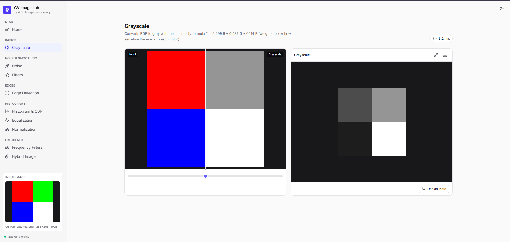

<sub>Computer Vision · Task 1 · Systems & Biomedical Engineering, Cairo University</sub>

</div>

---

## 👥 Team

<table align="center">
  <tr>
    <td align="center" width="200">
      <a href="https://github.com/YomnaSabry172"></a><br />
      <b>Yomna Sabry</b><br />
      <sub>Team lead</sub><br />
      <sub>UI, shared utilities, grayscale, integration</sub>
    </td>
    <td align="center" width="200">
      <br />
      <b>Ziad Osama</b><br />
      <sub>Noise & smoothing</sub><br />
      <sub>Noise, spatial filters, convolution engine</sub>
    </td>
    <td align="center" width="200">
      <a href="https://github.com/HanaOuda05"></a><br />
      <b>Hana Gamal Ouda</b><br />
      <sub>Edges & frequency</sub><br />
      <sub>Edge detection, Fourier filters, hybrid images</sub>
    </td>
    <td align="center" width="200">
      <br />
      <b>Alaa Essam</b><br />
      <sub>Histograms</sub><br />
      <sub>Histograms, PDF/CDF, equalization, normalization</sub>
    </td>
  </tr>
</table>

Each person owns their code end to end (see the `# Owner:` header at the top of every source file). The full ownership map is in [Team contributions](#-team-contributions).

---

## ✨ Features

| # | Feature | Method | From scratch? | Owner |
|:-:|---|---|:-:|---|
| 1 | [Noise](#1-noise) | Uniform, Gaussian, salt & pepper | Salt & pepper ✅ · uniform/Gaussian use NumPy random | Ziad |
| 2 | [Low-pass filters](#2-low-pass-filters) | Average, Gaussian, median · manual **and** SciPy twin | ✅ | Ziad |
| 3 | [Edge detection](#3-edge-detection) | Sobel, Prewitt, Roberts, Canny | ✅ (Canny uses `cv2.Canny`) | Hana |
| 4 | [Histogram & PDF](#4--8-histograms-pdf-and-cdf) | Per-channel counts and probabilities | ✅ | Alaa |
| 5 | [Equalization](#5-histogram-equalization) | CDF lookup table | ✅ | Alaa |
| 6 | [Normalization](#6-min-max-normalization) | Min-max stretch to 0–255 | ✅ | Alaa |
| 7 | [Grayscale](#7-grayscale-conversion) | `0.299 R + 0.587 G + 0.114 B` | ✅ | Yomna |
| 8 | [R, G, B histograms + CDF](#4--8-histograms-pdf-and-cdf) | Reuses feature 4 | ✅ | Alaa |
| 9 | [Frequency filters](#9-frequency-domain-filters) | Ideal, Gaussian, Butterworth · low/high-pass | Masks ✅ · FFT via `np.fft` | Hana |
| 10 | [Hybrid images](#10-hybrid-images) | Low-pass A + high-pass B, reuses feature 9 | ✅ | Hana |

**UI highlights**

- 🔁 **One upload, every page.** A shared *working image* follows you between pages.
- ⛓️ **Chain operations.** *Use as input* on any result, for example *noise → filter → edges*. *Reset to original* starts over.
- 🎚️ **Live results.** Sliders send debounced requests, and stale requests are cancelled.
- ⚖️ **Manual vs built-in compare.** Both outputs, a difference image, timings, speed-up and max error.
- 📊 **Charts.** Histogram + CDF per channel, colored R / G / B / gray.
- 🔍 **Inspect.** Before/after slider, click to enlarge, download any result as PNG.
- 🌗 **Comfort.** Dark and light themes, phone layout, backend status light, processing time on every page.

---

## 🚀 Quick start

> **Needs:** Python 3.11+, Node.js 20.19+ (or 22.12+), npm and Git.

```bash
git clone https://github.com/YomnaSabry172/cv-image-processing-task1.git
cd cv-image-processing-task1
```

**1 · Backend** (terminal 1)

<details open>
<summary><b>Windows (PowerShell)</b></summary>

```powershell
cd backend
python -m venv .venv
.\.venv\Scripts\Activate.ps1
python -m pip install -r requirements.txt
python -m uvicorn app.main:app --reload
```
</details>

<details>
<summary><b>macOS / Linux</b></summary>

```bash
cd backend
python3 -m venv .venv
source .venv/bin/activate
python -m pip install -r requirements.txt
python -m uvicorn app.main:app --reload
```
</details>

**2 · Frontend** (terminal 2)

```bash
cd frontend
npm ci
npm run dev
```

**3 · Open** <http://localhost:5173>

| Service | URL |
|---|---|
| App | http://localhost:5173 |
| API | http://localhost:8000 |
| Interactive API docs | http://localhost:8000/docs |
| Health check | http://localhost:8000/api/health |

> [!NOTE]
> The frontend runs on port **5173** with `strictPort`, because the backend CORS setting only allows that origin. Set `VITE_API_URL` if the API runs somewhere other than `http://localhost:8000`.

### Using the app

1. Check that the backend status light in the top bar is green.
2. Upload a grayscale or RGB image on **Home** (PNG, JPG, BMP or WebP).
3. Open any feature page and move its sliders. Results update automatically.
4. Click **Use as input** to continue with a result on another page, or **Reset to original** to start over.

Images whose longest side is larger than 1024 px are downscaled (aspect ratio kept). Use PNG for exact-value experiments, because JPEG compression changes pixel values. Reloading the page clears the in-memory images.

---

## 🎛️ Parameters in action

Every animation below was rendered by running the project's own `backend/app/core/` functions over a range of parameter values. They show what you see in the app when you drag each slider. Below each animation you find the app screenshots used in the report and what to observe.

<details>
<summary><b>How the animations were made</b></summary>

A one-off script imported `core.noise`, `core.spatial`, `core.edges`, `core.frequency`, `core.hybrid` and `core.histogram`, called them once per parameter value, and saved the frames to [`docs/readme/`](docs/readme/). The input is [`docs/report/screenshots/B_original.png`](docs/report/screenshots/B_original.png) unless noted. Hybrid uses the disk and stripe images from [`CV_Test_Kit/images/`](CV_Test_Kit/images/). Fixed seeds keep every frame reproducible.
</details>

### 1. Noise

<sub>Owner: <b>Ziad Osama</b> · <a href="backend/app/core/noise.py"><code>core/noise.py</code></a></sub>

`Noise.apply()` converts the image to `float64`, lets the subclass corrupt it, clips to 0–255 and returns `uint8`. This prevents `uint8` overflow (250 + 10 would wrap to 4).

| Type | Model | Controls (app range) | Effect of raising the value |
|---|---|---|---|
| Uniform | $I + U(\text{low}, \text{high})$ | low, high: −128 … 128 | Wider bounds give stronger, flat-distributed grain |
| Gaussian | $I + \mathcal{N}(\mu, \sigma^2)$ | mean μ: −64 … 64 · sigma σ: 1 … 100 | μ shifts brightness. σ spreads the noise |
| Salt & pepper | Pixel set to 255 or 0 | density: 0 … 0.5 · salt ratio: 0 … 1 | Density = share of corrupted pixels. Ratio = share that is white |

All types accept a **seed**, so the same settings give the same noise. Salt & pepper is from scratch: one random mask per pixel position, applied to all three channels, so impulses are black/white and not colored.

<table>
<tr><td align="center"><b>Gaussian noise · σ from 5 to 100</b></td><td align="center"><b>Salt & pepper · density from 0 to 0.5</b></td></tr>
<tr>
<td>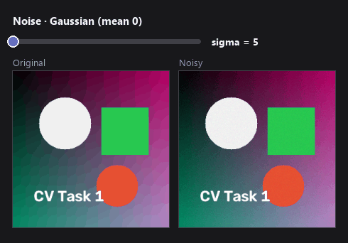</td>
<td>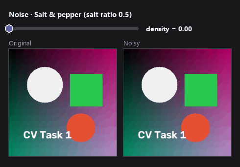</td>
</tr>
</table>

<details>
<summary>📸 App screenshots (constant-gray test image, seed 42)</summary>

**Uniform noise: low −30, high 30**


**Gaussian noise: mean 0, sigma 25**


**Salt & pepper: density 10 %, salt ratio 50 %**


| Original | Uniform | Gaussian | Salt & pepper |
|:-:|:-:|:-:|:-:|
|  | 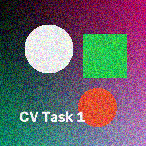 |  |  |
</details>

> **Observe:** clipping at 0 and 255 changes the final mean and histogram, so a large σ on a dark or bright image is not symmetric.

### 2. Low-pass filters

<sub>Owner: <b>Ziad Osama</b> · <a href="backend/app/core/spatial.py"><code>core/spatial.py</code></a> · <a href="backend/app/core/convolution.py"><code>core/convolution.py</code></a> · <a href="backend/app/core/kernels.py"><code>core/kernels.py</code></a></sub>

| Filter | Operation | Controls (app range) |
|---|---|---|
| Average | Equal weights $1/k^2$ | kernel size: 3 … 15 (odd) |
| Gaussian | $e^{-(x^2+y^2)/2\sigma^2}$, normalized to sum 1 | kernel size · sigma σ: 0.2 … 5 |
| Median | Middle value of each $k \times k$ window | kernel size |

All three go through one function, `smooth()`. RGB images are filtered per channel.

**Kernel size on salt & pepper noise.** Average and Gaussian smear the impulses into gray blobs. Median removes them, but a large kernel starts to eat thin details such as the text.

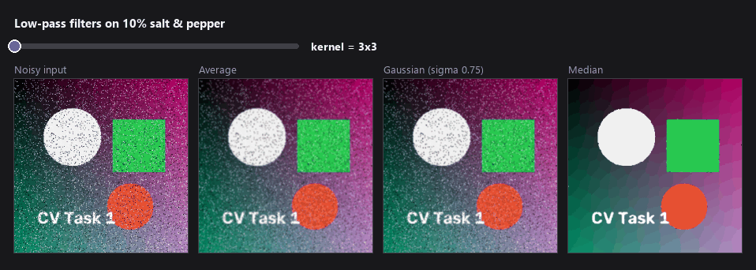

<sub>Gaussian σ in this animation = kernel size / 4.</sub>

**Sigma at a fixed 15×15 kernel.** A small σ keeps most weight in the center pixel (little blur). A large σ approaches the average filter.

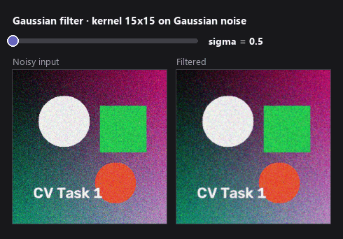

<details>
<summary>📸 App screenshots and filter-vs-noise grid</summary>

**Average filter: vertical step, 11×11, Compare mode**


**Gaussian filter: same step, 13×13, σ = 2, Compare mode**


**Median filter: salt & pepper image, 3×3**


| Noise ↓ / Filter → | Average | Gaussian | Median |
|:-:|:-:|:-:|:-:|
| **Gaussian** | 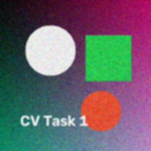 |  | 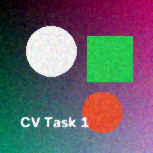 |
| **Salt & pepper** |  | 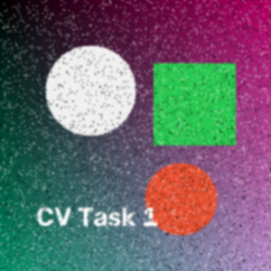 |  |
</details>

#### ⚖️ Manual vs built-in (TA requirement)

Each convolution-based operation has two twins, chosen with the **Built-in / Manual / Compare** toggle:

| | Manual (ours) | Built-in |
|---|---|---|
| Correlation | Loop over **kernel positions**, not pixels: 9 NumPy array additions for a 3×3 kernel | `scipy.ndimage.correlate` |
| Median | `sliding_window_view` + `np.median` | `scipy.ndimage.median_filter` |
| Borders | `np.pad(mode="symmetric")` | `mode="reflect"` (the same rule under SciPy's name) |

```python
# correlation: out[i, j] = sum over (a, b) of k[a, b] * padded[i + a, j + b]
for a in range(kh):
    for b in range(kw):
        out += kernel[a, b] * padded[a:a + H, b:b + W]
```

**Compare** mode runs both and shows both outputs, the absolute difference image, each time in ms, the speed-up and the max absolute difference. A black difference image with max difference 0 shows that the two paths agree on that input.

| Manual | Built-in | \|Manual − Built-in\| |
|:-:|:-:|:-:|
|  |  | 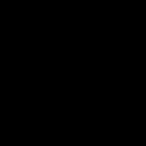 |

Timings depend on hardware, image size and warm-up, so one speed-up figure is not a general benchmark.

### 3. Edge detection

<sub>Owner: <b>Hana Gamal Ouda</b> · <a href="backend/app/core/edges.py"><code>core/edges.py</code></a></sub>

Sobel, Prewitt and Roberts share one `EdgeDetector` class: convert to gray, correlate with $K_x$ and $K_y$, then

$$M = \sqrt{G_x^2 + G_y^2}, \qquad \theta = \operatorname{atan2}(G_y, G_x)$$

| Operator | Size | Character | Controls |
|---|:-:|---|---|
| Sobel | 3×3 | Derivative with 1-2-1 smoothing across it | Built-in / Manual |
| Prewitt | 3×3 | Derivative with equal weights | Built-in / Manual |
| Roberts | 2×2 | Two diagonal differences, thinnest response | Built-in / Manual |
| Canny | — | `cv2.Canny`: thinning + hysteresis | low, high: 0 … 255 · pre-blur toggle · blur σ: 0.4 … 4 |

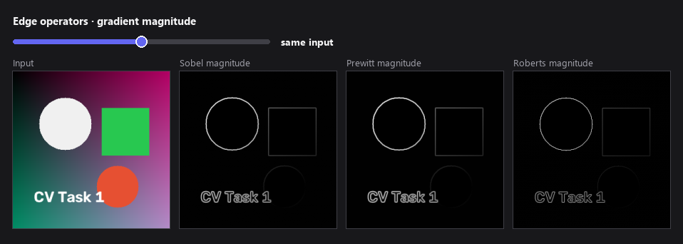

**Canny thresholds, with and without pre-blur.** On a noisy input, low thresholds turn grain into false edges. A Gaussian pre-blur (σ = 1.4) removes most of them before Canny runs. Raising the thresholds keeps only the strongest boundaries.

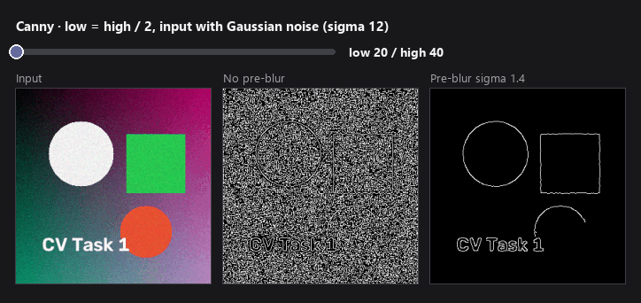

<details>
<summary>📸 App screenshots (step test images)</summary>

**Sobel: vertical step. Gx finds the boundary**


**Sobel: horizontal step. Gy finds the boundary**


**Prewitt: vertical step**


**Roberts: vertical step, diagonal responses**


**Canny: RGB patches, thresholds 20 / 60, pre-blur σ = 1**

</details>

> **Observe:** Gx responds to vertical boundaries and Gy to horizontal ones. Raw gradients stay signed internally. Only the previews take $|x|$ or a min-max stretch. Edges use grayscale brightness, so two colors with the same gray value give no edge.

### 4 & 8. Histograms, PDF and CDF

<sub>Owner: <b>Alaa Essam</b> · <a href="backend/app/core/histogram.py"><code>core/histogram.py</code></a></sub>

$$h(k) = \#\{\text{pixels with value } k\}, \qquad p(k) = \frac{h(k)}{N}, \qquad C(k) = \sum_{i=0}^{k} p(i)$$

Counting uses `np.add.at`. There is no `np.histogram`, `np.bincount` or `cv2.calcHist`. A gray image shows one chart. An RGB image shows three (R, G, B), each with its CDF on a second 0–1 axis, plus min, max, mean and standard deviation per channel. A steep CDF means many pixels in that range. A flat part means few or none.

| Grayscale ramp: flat histogram, straight CDF | RGB patches: separate R, G, B peaks |
|:-:|:-:|
|  |  |

### 5. Histogram equalization

<sub>Owner: <b>Alaa Essam</b></sub>

$$T(k) = \operatorname{round}\big(255 \cdot C(k)\big), \qquad I_{out}(x, y) = T\big(I_{in}(x, y)\big)$$

A lookup table built from the CDF spreads crowded gray levels apart. Example: `[0, 0, 1, 2] → [128, 128, 191, 255]`. Levels are moved, never split, so the result is not perfectly flat. RGB channels are equalized separately, which can shift colors.


### 6. Min-max normalization

<sub>Owner: <b>Alaa Essam</b></sub>

$$I_{out} = \operatorname{round}\left(\frac{I - I_{min}}{I_{max} - I_{min}} \times 255\right)$$

A linear stretch with one global min and max, so colors stay balanced. Example: `[100, 105, 110] → [0, 128, 255]`. The histogram keeps its shape and only gets wider. A constant image returns zeros (no division by zero). The same function also makes signed results (edges, high-pass) viewable across the app.


**Equalization vs normalization on the same dark input**

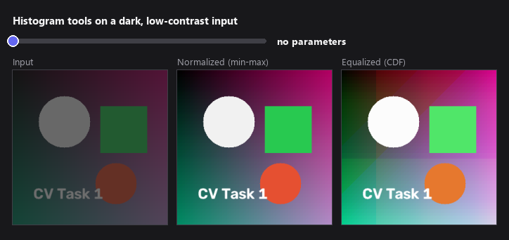

> **Observe:** normalization cannot help an image that already spans 0–255. Equalization still changes it, because it follows the distribution and not only the range.

### 7. Grayscale conversion

<sub>Owner: <b>Yomna Sabry</b> · <a href="backend/app/core/color.py"><code>core/color.py</code></a></sub>

$$Y = 0.299\,R + 0.587\,G + 0.114\,B$$

The weights follow how sensitive the eye is to each color (green most, blue least). Pure red, green and blue become 76, 149 and 29. A gray input is returned unchanged.


### 9. Frequency-domain filters

<sub>Owner: <b>Hana Gamal Ouda</b> · <a href="backend/app/core/frequency.py"><code>core/frequency.py</code></a></sub>

$$F = \operatorname{fftshift}(\operatorname{fft2}(I)), \quad G = F \cdot H, \quad g = \Re\{\operatorname{ifft2}(\operatorname{ifftshift}(G))\}$$

Masks are built from scratch. $D$ is the distance from the spectrum center, $D_0$ the cutoff, $n$ the Butterworth order:

| Mask | Low-pass $H$ | Weight at $D_0$ | Character |
|---|---|:-:|---|
| Ideal | $1$ if $D \le D_0$, else $0$ | 1 → 0 | Sharp cut, visible **ringing** |
| Gaussian | $e^{-D^2 / 2D_0^2}$ | ≈ 0.607 | Smooth, no ringing |
| Butterworth | $1 / (1 + (D/D_0)^{2n})$ | 0.5 | Sharpness set by $n$ |

High-pass $= 1 - H_{LP}$. **Controls:** kind (low/high), shape, cutoff $D_0$: 1 … 200 px, order $n$: 1 … 10 (Butterworth only). Panels: spectrum, mask, filtered spectrum, result.

**Cutoff $D_0$.** A small cutoff keeps only the center of the spectrum, so low-pass gives heavy blur and high-pass keeps only fine edges. A large cutoff lets more through.

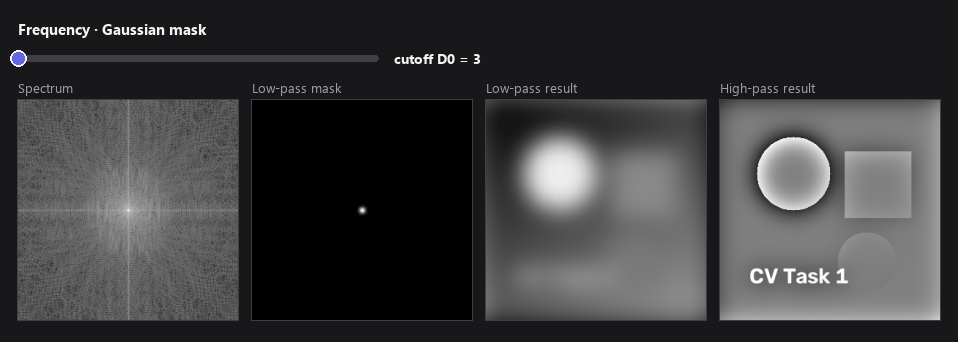

**Mask shape.** At the same cutoff, the ideal mask shows ripples (ringing) around edges, while Gaussian stays smooth and Butterworth sits in between.

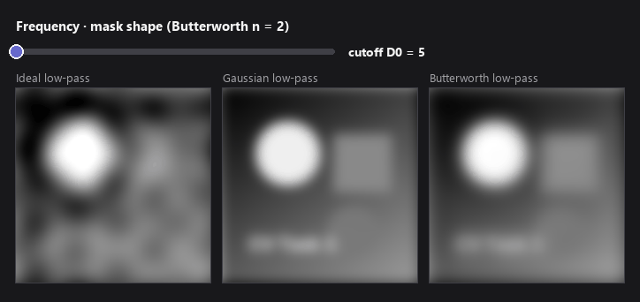

**Butterworth order $n$.** Low $n$ is close to Gaussian. High $n$ approaches the ideal mask, and the ringing comes back.

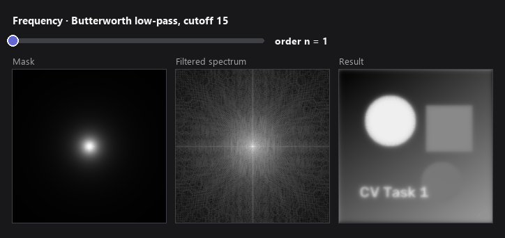

<details>
<summary>📸 App screenshots</summary>

**Gaussian low-pass: disk, cutoff 10**


**Gaussian high-pass: same disk, cutoff 10 (mid-gray = zero)**


**Ideal low-pass: vertical step, cutoff 10**


**Butterworth low-pass: same step, cutoff 10, order 2**

</details>

> **Observe:** the high-pass result is signed, so the page shows `clip(raw + 128)`. Mid-gray means zero. Spectra use $\log(1 + |F|)$ only for display. The filtering keeps the full complex values.

### 10. Hybrid images

<sub>Owner: <b>Hana Gamal Ouda</b> · <a href="backend/app/core/hybrid.py"><code>core/hybrid.py</code></a></sub>

$$I_{hybrid} = \operatorname{clip}\big(LP(A) + HP(B),\ 0,\ 255\big)$$

`HybridImage` reuses `FrequencyFilter` and has no FFT code of its own. B is resized to A's size. If either image is gray, both become gray. The signed high-pass is added **before** clipping: 150 + (−30) = 120, while clipping the detail first would wrongly give 150.

**Controls:** mask shape, low-pass cutoff (A): 1 … 100, high-pass cutoff (B): 1 … 100, swap A ↔ B, *View small*.

| Low cutoff (A) sweep | Zoom out: stripes fade, the disk stays |
|:-:|:-:|
| 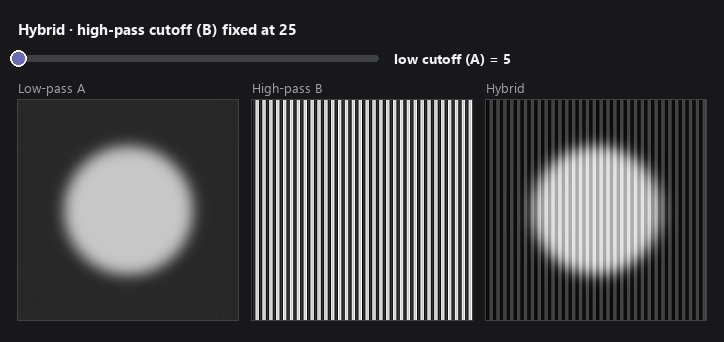 | 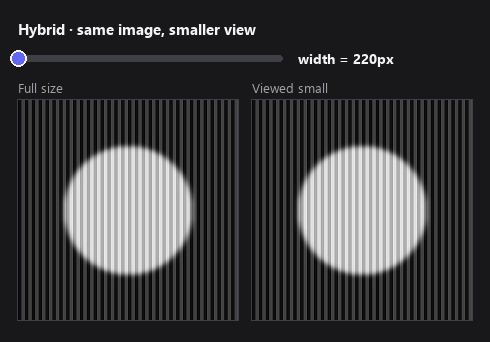 |

<details>
<summary>📸 App screenshots (disk A, stripes B, Gaussian, cutoffs 15 / 25)</summary>


</details>

> **Observe:** close up, B's fine detail dominates. From far away (or small), only A's broad shape survives. The effect needs aligned inputs with similar layout.

---

## 🏗️ Architecture

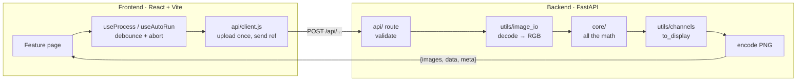

- **Math lives in `core/`.** Routes only decode → call core → encode.
- **Upload once.** `POST /api/images` stores the image and returns a ref. Later requests send the ref instead of the full image. After a server restart, the client re-uploads on `410` automatically.
- **One color convention.** OpenCV's BGR is converted to RGB once on decode and back once on encode.
- **Safe arithmetic.** Everything is `float64` inside, then `clip` → `uint8` at the end.

<details>
<summary><b>📁 Project structure (with owners)</b></summary>

```
cv-image-processing-task1/
├── backend/
│   ├── app/
│   │   ├── main.py, schemas.py          FastAPI app, CORS, routers                   Yomna
│   │   ├── api/                          one thin route per feature                   (feature owner)
│   │   ├── core/
│   │   │   ├── color.py                  grayscale, channels                          Yomna
│   │   │   ├── convolution.py            padding, manual + SciPy correlation          Ziad
│   │   │   ├── kernels.py                box, Gaussian, Sobel, Prewitt, Roberts       Ziad
│   │   │   ├── compare.py                run_both(): timing + difference              Ziad
│   │   │   ├── noise.py                  Noise classes + factory                      Ziad
│   │   │   ├── spatial.py                smooth(): average / Gaussian / median        Ziad
│   │   │   ├── edges.py                  EdgeDetector, Canny                          Hana
│   │   │   ├── frequency.py              FrequencyFilter                              Hana
│   │   │   ├── hybrid.py                 HybridImage                                  Hana
│   │   │   └── histogram.py              histogram, PDF, CDF, equalize, normalize     Alaa
│   │   └── utils/                        image_io, channels (to_display)              Yomna
│   └── tests/                            unit + API tests
├── frontend/src/
│   ├── components/ (layout + ui)         shared UI kit                                Yomna
│   ├── context/, hooks/, api/, lib/      image state, requests, navigation            Yomna
│   └── pages/
│       ├── Home, Grayscale                                                            Yomna
│       ├── Noise, Filters                                                             Ziad
│       ├── Edges, Frequency, Hybrid                                                   Hana
│       └── Histogram, Equalize, Normalize                                             Alaa
├── CV_Test_Kit/                          extended tests, test images, manual plan
└── docs/
    ├── readme/                           parameter-sweep animations for this README
    └── report/                           per-member reports + screenshots
```
</details>

<details>
<summary><b>🧱 From scratch vs library</b></summary>

| Used from a library | Written by us |
|---|---|
| `cv2.imdecode` / `imencode`, `cv2.resize` | Kernels, padding, correlation, median |
| `cv2.Canny` (Canny only) | Salt & pepper noise |
| NumPy random (uniform, Gaussian noise) | Histogram, PDF, CDF, equalization, normalization |
| `np.fft` (FFT and inverse only) | Frequency masks, hybrid composition |
| SciPy `correlate` / `median_filter` (**built-in twin only**) | Grayscale conversion |

Not used anywhere in the from-scratch code: `cv2.filter2D`, `cv2.GaussianBlur`, `cv2.medianBlur`, `cv2.Sobel`, `cv2.equalizeHist`, `cv2.calcHist`, `cv2.normalize`, `cv2.cvtColor` (for grayscale), `np.histogram`, `np.bincount`.
</details>

---

## 📡 API reference

All processing endpoints are `POST` with a JSON body. Image fields take a data URL or an upload ref. Every response uses one envelope:

```json
{ "images": { "<name>": "data:image/png;base64,..." }, "data": {}, "meta": { "time_ms": 12.3 } }
```

<details>
<summary><b>Endpoints</b></summary>

| Endpoint | Request | Images returned | Data returned |
|---|---|---|---|
| `GET /api/health` | — | — | `{status: "ok"}` |
| `/api/images` | `image` | — | `ref` |
| `/api/grayscale` | `image` | `result` | — |
| `/api/noise` | `image, type, low?, high?, mean?, sigma?, density?, salt_ratio?, seed?` | `result` | — |
| `/api/filter` | `image, method, kernel_size, sigma?, implementation` | `result` or `manual, builtin, difference` | compare: times, speed-up, max diff |
| `/api/edges` | `image, method, implementation?, low?, high?, blur_sigma?` | `gx, gy, magnitude, direction` or `result` | — |
| `/api/histogram` | `image` | — | `mode`, per-channel stats |
| `/api/equalize` | `image` | `result` | `before`, `after` stats |
| `/api/normalize` | `image` | `result` | `before`, `after` stats |
| `/api/frequency` | `image, kind, shape, cutoff, order?` | `result, spectrum, mask, filtered_spectrum` | — |
| `/api/hybrid` | `image_a, image_b, low_cutoff, high_cutoff, shape` | `hybrid, low_component, high_component` | — |

Invalid parameters return a readable `400`. Schema mismatches return `422`. An unknown upload ref returns `410`. Live schema: <http://localhost:8000/docs>.
</details>

---

## 🧪 Testing

```bash
cd backend
python -m pip install pytest httpx
python -m pytest -q tests ../CV_Test_Kit/qa_tests
```

**Result on 27 October 2026 (Windows): `242 passed, 1 warning`** (the warning is a TestClient/HTTPX deprecation notice).

The suites cover known numerical outputs, gray and RGB inputs, manual = built-in agreement, FFT reconstruction, signed hybrid addition, the upload cache, invalid and corrupt inputs, and extreme image sizes. [`CV_Test_Kit/TEST_PLAN.md`](CV_Test_Kit/TEST_PLAN.md) holds the manual browser checklist.

<details>
<summary><b>⚠️ Limitations</b></summary>

- Edges use grayscale brightness, so color-only boundaries can disappear.
- Equalization can amplify noise and shift RGB colors, and does not guarantee a flat histogram.
- One extreme pixel can limit the effect of global min-max normalization.
- The FFT assumes the image repeats at its borders (no padding), so wrap-around artefacts can appear.
- Downloaded or reused previews contain display pixels, not the signed raw arrays.
- Hybrid resizing matches size but does not align objects or keep B's aspect ratio.
- Large manual median kernels use more memory. One timing run is not a benchmark.
</details>

---

## 🤝 Team contributions

| Member | Features | Main files | Report |
|---|---|---|---|
| **Yomna Sabry** · lead | 7 Grayscale · UI shell, design system, shared components, utilities, integration | `core/color.py`, `utils/`, `frontend/` | [report_Lead.md](docs/report/report_Lead.md) |
| **Ziad Osama** | 1 Noise · 2 Low-pass filters · manual/built-in compare | `core/noise.py`, `spatial.py`, `convolution.py`, `kernels.py`, `compare.py` | [report_B.md](docs/report/report_B.md) |
| **Hana Gamal Ouda** | 3 Edges · 9 Frequency filters · 10 Hybrid · test kit | `core/edges.py`, `frequency.py`, `hybrid.py`, `CV_Test_Kit/` | [report_C.md](docs/report/report_C.md) |
| **Alaa Essam** | 4 Histogram · 5 Equalization · 6 Normalization · 8 RGB histograms + CDF | `core/histogram.py` | [report_D.md](docs/report/report_D.md) |

Full spec, rules and contracts: [CLAUDE.md](CLAUDE.md).

## 📚 References

1. A. Oliva, A. Torralba, P. G. Schyns, "Hybrid images," *ACM SIGGRAPH*, 2006.
2. R. C. Gonzalez, R. E. Woods, *Digital Image Processing*, 4th ed. (spatial filtering, histograms, frequency domain).
3. [NumPy padding modes](https://numpy.org/doc/stable/reference/generated/numpy.pad.html) · [NumPy FFT](https://numpy.org/doc/stable/reference/routines.fft.html) · [`sliding_window_view`](https://numpy.org/doc/stable/reference/generated/numpy.lib.stride_tricks.sliding_window_view.html)
4. [SciPy `ndimage.correlate`](https://docs.scipy.org/doc/scipy/reference/generated/scipy.ndimage.correlate.html) · [`median_filter`](https://docs.scipy.org/doc/scipy/reference/generated/scipy.ndimage.median_filter.html)
5. [OpenCV Canny tutorial](https://docs.opencv.org/4.x/da/d22/tutorial_py_canny.html)
6. [FastAPI](https://fastapi.tiangolo.com/) · [React](https://react.dev/) · [Recharts](https://recharts.org/)

<div align="center">
<br />
<sub>Built by Yomna, Ziad, Hana and Alaa · MIT License</sub>
</div>
