CV Image Lab — Classical Image Processing
An interactive image-processing application built for Computer Vision Task 1. The application supports grayscale and RGB inputs, controlled noise generation, spatial filtering, gradient-based edge detection, intensity statistics and enhancement, Fourier-domain filtering, and hybrid images.
The project pairs readable numerical implementations with an interactive React interface. Users can change parameters, inspect intermediate results, compare manual and library implementations, download outputs, and chain operations through a shared working image.
Testing: the complete backend test suite passed on the maintainer's Windows checkout: 230 tests passed. Browser workflow verification and frontend build evidence are documented separately below.

Application overview
[CV Image Lab interface](docs/report/screenshots/01-overview.png)

Contents
- Features
- Technology and architecture
- Installation and running
- Working with images
- Algorithms and implementation
- API reference
- Testing and evidence
- Limitations and interpretation
- Team contributions
- References
Features
Assignment feature	Implementation	User controls and outputs
1. Noise generation	Additive uniform, additive Gaussian, and salt-and-pepper noise	Bounds; mean/sigma; density/salt ratio; reproducible random seed and new-noise control
2. Spatial low-pass filtering	Average, Gaussian, and median; manual and SciPy paths	Odd kernel size; Gaussian sigma; manual/built-in/compare mode
3. Edge detection	Sobel, Prewitt, Roberts, and OpenCV Canny	Signed gradients internally; displayed component strengths, magnitude and direction; Canny thresholds and optional Gaussian pre-blur
4. Histograms and distributions	Per-channel histogram and normalized probabilities	Grayscale or separate R/G/B statistics and charts
5. Histogram equalization	Direct CDF lookup-table mapping	Before/after images, distributions and statistics
6. Min-max normalization	Linear stretching into 0–255	Before/after images and statistics
7. Grayscale conversion	Weighted RGB-to-gray conversion	Original/result comparison and reusable grayscale output
8. Cumulative distribution	Cumulative sum of per-level probabilities	CDF curve with a 0–1 probability scale
9. Frequency-domain filters	Low-pass and high-pass; Ideal, Gaussian and Butterworth masks	Cutoff, Butterworth order, original spectrum, mask, filtered spectrum and reconstructed image
10. Hybrid images	Low-pass image A plus signed high-pass image B	Independent cutoffs, mask shape, separate components, input swapping and smaller-view previews

Additional interface features include image upload, before/after sliders where applicable, enlarged previews, PNG output downloads, a shared working input, reset to original, light/dark presentation, backend status, and processing-time displays.
Technology and architecture
Layer	Main tools	Responsibility
Frontend	React 18, Vite, Tailwind CSS, Recharts, Lucide	Uploads, controls, request state, image panels and charts
API	FastAPI, Pydantic, Uvicorn	Request parsing, validation, decoding, algorithm calls and responses
Numerical processing	NumPy, SciPy, OpenCV	Array arithmetic, correlation, random sampling, FFTs, image codecs and Canny
Tests	pytest, HTTPX / FastAPI TestClient	Numerical properties, regression checks and in-process API tests

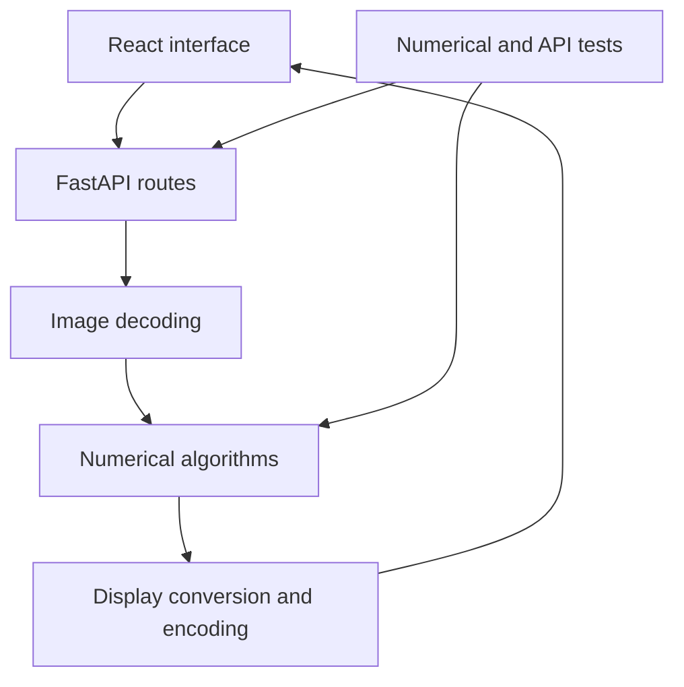
Processing mathematics live in backend/app/core/. API routes in backend/app/api/ handle transport and validation. Shared image and channel helpers live in backend/app/utils/. React feature pages live in frontend/src/pages/.
Path	Purpose
backend/app/main.py	FastAPI entry point, CORS and router registration
backend/app/core/noise.py	Noise base class, generators and factory
backend/app/core/kernels.py	Spatial and derivative kernels
backend/app/core/convolution.py	Shared manual/SciPy correlation engine and padding
backend/app/core/spatial.py	Average, Gaussian and median filtering
backend/app/core/compare.py	Timings and manual/built-in differences
backend/app/core/edges.py	Reusable gradient detector and Canny wrapper
backend/app/core/histogram.py	Histograms, PDF, CDF, equalization, normalization and statistics
backend/app/core/frequency.py	Frequency masks, transforms and display outputs
backend/app/core/hybrid.py	Composition of low-pass and high-pass components
frontend/src/context/	Shared original/working-image state
frontend/src/hooks/	Processing requests and automatic execution
backend/tests/	Original repository tests
CV_Test_Kit/	Extended tests, diagnostic inputs, manual plan and result templates
docs/SCREENSHOT_GUIDE.md	Exact capture steps and filenames
docs/report/screenshots/	Screenshots captured from the actual running application

Implementation boundaries
- Kernels, histogram counting, equalization lookup tables, grayscale conversion and frequency masks are constructed directly with NumPy.
- Manual correlation is vectorized across image pixels and loops over kernel positions.
- Manual median uses sliding-window views and NumPy median; it does not call SciPy's median filter.
- Built-in comparison paths use SciPy correlation and median filtering.
- Random sampling uses NumPy's generator; salt-and-pepper assignment uses explicit spatial masks.
- Fourier transforms use NumPy FFT functions. Hybrid generation reuses FrequencyFilter rather than duplicating FFT code.
- Canny detection and image decoding/encoding use OpenCV; Canny is not claimed as a from-scratch implementation.
Installation and running
Prerequisites
- Python 3.11 or newer.
- Node.js compatible with the checked-in frontend lockfile. Its Vite/Rolldown toolchain declares Node 20.19+ in the 20.x line or Node 22.12+; use an installed version satisfying the lockfile's engines.
- npm, Git, and a modern browser.
Get the repository
git clone https://github.com/YomnaSabry172/cv-image-processing-task1.git
cd cv-image-processing-task1
If the repository already exists locally, open its root folder. All relative commands below assume this root unless otherwise stated.
Backend setup — Windows PowerShell
cd backend
python -m venv .venv
.\.venv\Scripts\Activate.ps1
python -m pip install -r requirements.txt
python -m uvicorn app.main:app --reload
Backend: http://localhost:8000
Interactive API documentation: http://localhost:8000/docs
Health endpoint: http://localhost:8000/api/health
If an existing .venv is already configured, activate it instead of creating another environment.
Frontend setup — second terminal
cd frontend
npm ci
npm run dev
Open http://localhost:5173. npm ci installs from the checked-in lockfile. If intentionally working without a lockfile, use npm install instead.
The Vite server is configured for port 5173 with strictPort. Backend CORS currently allows http://localhost:5173; use this exact browser origin during local development.
macOS / Linux virtual environment
Use the same backend commands, replacing activation with:
source .venv/bin/activate
Frontend build
From frontend/:
npm run build
A successful build confirms frontend compilation. It does not verify live API connectivity or browser interactions. Record the actual build result before presenting it as verified.

Working with images
1. Start both servers and confirm the backend status is online.
2. Upload a grayscale or RGB image. PNG, JPG, BMP and WebP are the documented demonstration formats.
3. Choose a feature and adjust its parameters; processing runs automatically after control/input changes.
4. Compare the input and output or inspect intermediate panels/charts.
5. Download a result or choose Use as input to continue with that result on another feature page.
6. Choose Reset to original before an independent experiment.
Images larger than the configured maximum are downscaled so their longest side is approximately 1024 pixels, preserving aspect ratio and keeping both dimensions at least one pixel. Use PNG fixtures for exact-value experiments; JPEG compression changes pixel values.
Working-image behaviour: “Use as input” replaces the shared working image but does not navigate to another feature. A page with automatic processing can immediately calculate a new preview from the updated input. For noise-removal demonstrations, upload 08_salt_pepper_seed42.png directly into Filters, or click Use as input once on Noise and then navigate to Filters. Do not repeatedly promote the Noise preview unless cumulative corruption is intended.
Reloading the page clears in-memory image state. Large-image processing uses the resized working image rather than the original full-resolution source.
Algorithms and implementation

1. Noise generation
The shared Noise.apply() method converts input to floating point, delegates corruption to a subclass, clips the result to 0–255, and returns uint8. This avoids unsigned overflow during addition.
Type	Model	Parameters	Interpretation
Uniform	output = input + U(low, high)	low, high	Bounded additive perturbation
Gaussian	output = input + N(mean, sigma²)	mean, sigma	Mean shifts brightness; sigma controls spread
Salt and pepper	Replace selected pixels with 0 or 255	density, salt_ratio	Density is the expected corrupted share; ratio controls the white share

RGB uniform/Gaussian samples follow the full array shape. Salt-and-pepper noise samples one spatial mask and applies each selected pixel position to all channels, producing black/white impulses rather than separate coloured impulses. A seed makes the sampling repeatable for the same operation and input shape. Clipping and integer conversion can change the final mean and distribution.
Noise examples
Input: CV_Test_Kit/images/01_constant_128.png. Use seed 42 for each independent example.
Uniform noise — low −30, high 30
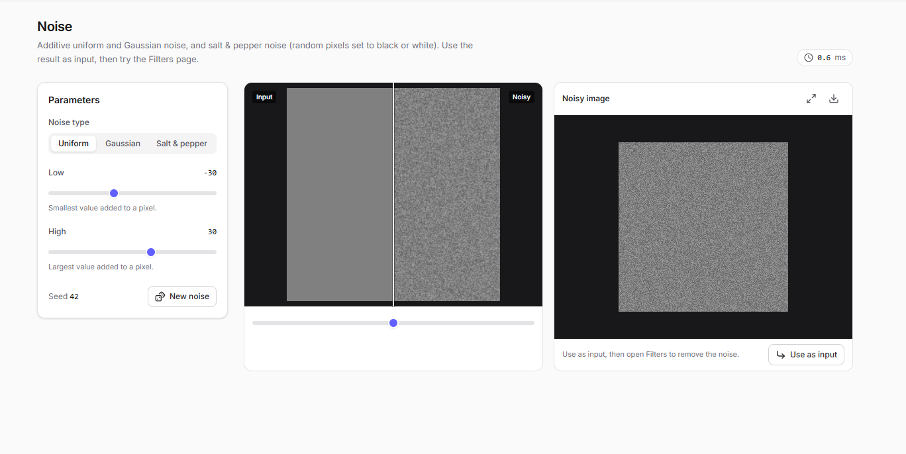 

Gaussian noise — mean 0, sigma 25
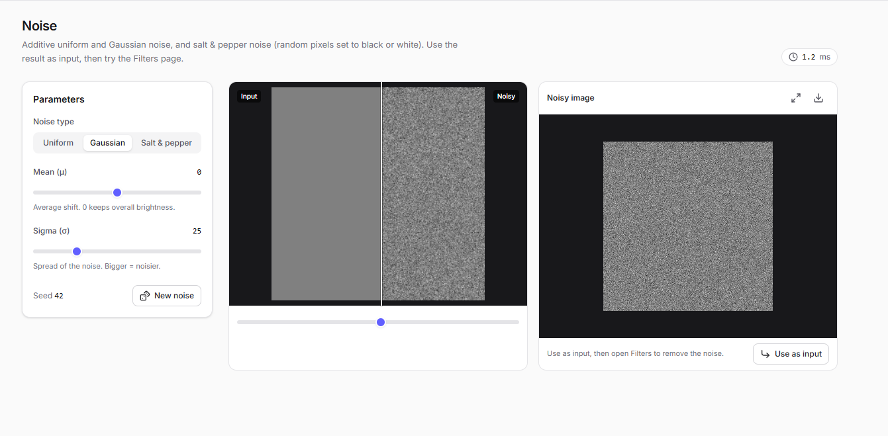

Salt-and-pepper noise — density 10%, salt ratio 50%
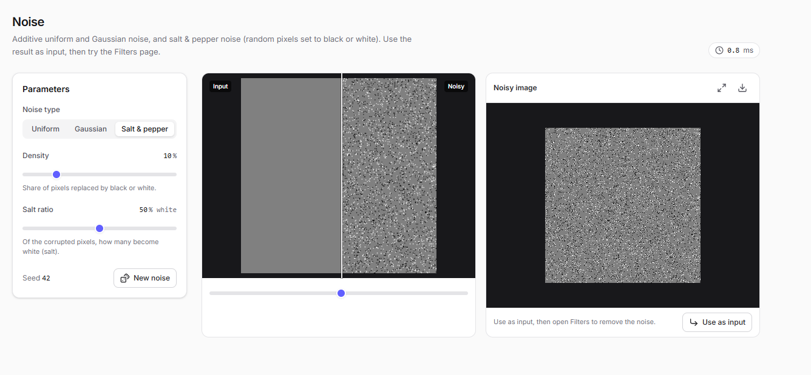 

2. Spatial filters and implementation comparison
Filter	Operation	Typical demonstration
Average	Equal weights 1 / k² across the neighbourhood	Smoothing with increasing kernel size
Gaussian	Distance-based weights, normalized to sum to one	Smoothing while varying sigma at fixed kernel size
Median	Middle neighbourhood value	Removing isolated salt-and-pepper impulses

Kernel sizes are positive odd integers. Gaussian sigma must be finite and positive. RGB images are processed channel by channel.
The shared engine performs correlation, despite the historical convolution.py filename: kernels are not flipped. NumPy symmetric padding in the manual implementation matches SciPy reflect boundary handling. For even Roberts kernels the anchor convention produces asymmetric top/left padding.
Compare mode displays manual and built-in results, an absolute-difference image, both execution times, maximum pixel difference and manual_time / builtin_time. A black difference image and a small numeric difference support agreement on that input; they do not prove correctness for all inputs. Timings depend on hardware, image size, method and warm-up.
Spatial-filter examples
Average filter — vertical step, 11x11 kernel, Compare mode
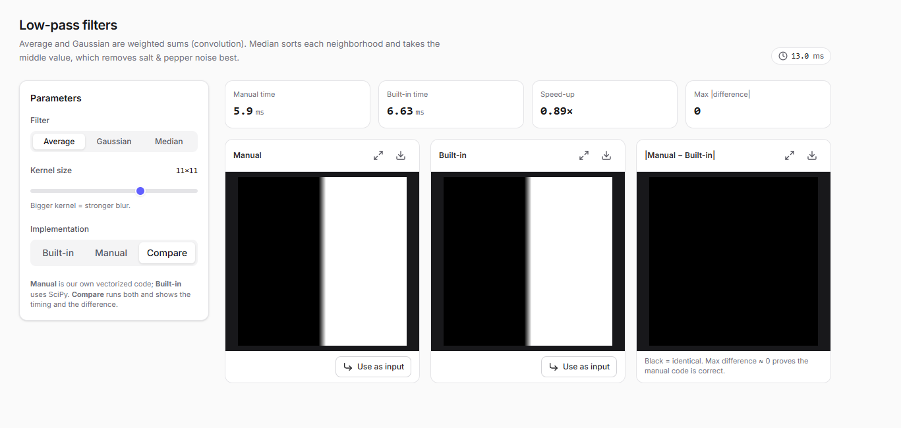 

Gaussian filter — same original vertical step, 13×13 kernel, sigma 2, Compare mode
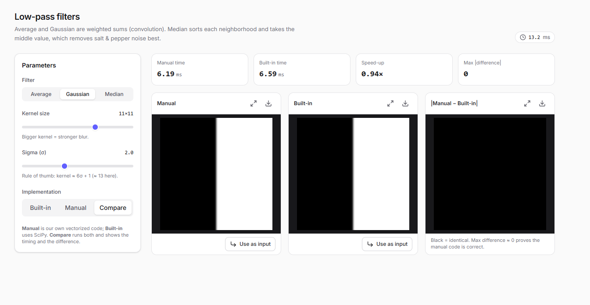

Median filter — salt-and-pepper fixture, 3x3
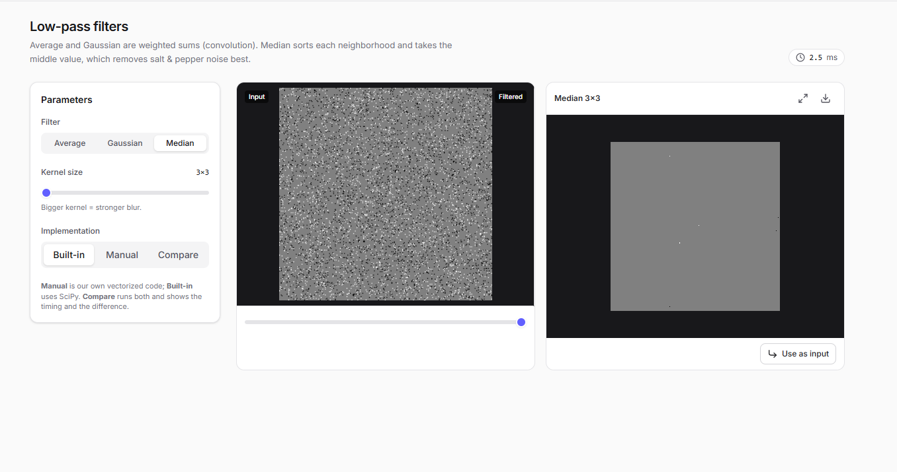 

The comparison capture should include both outputs, their absolute difference and the actual reported timing/difference values.
3. Edge detection
Sobel and Prewitt approximate horizontal and vertical brightness derivatives. Roberts measures two diagonal differences. All three share EdgeDetector: grayscale conversion, application of two kernels, magnitude and direction calculation.
For Sobel/Prewitt:
\(M = \sqrt{G_x^2 + G_y^2}, \qquad \theta = \operatorname{atan2}(G_y,G_x).\)
Operator	Neighbourhood	Key distinction
Sobel	3×3	Derivative with perpendicular 1–2–1 weighting
Prewitt	3×3	Derivative with equal perpendicular weights
Roberts	2×2	Diagonally opposite pixel differences
Canny	Multi-stage library detector	Optional explicit Gaussian pre-blur, suppression and hysteresis selection

For Sobel/Prewitt, Gx responds to vertical boundaries and Gy to horizontal boundaries. Gradient direction points toward increasing brightness, perpendicular to the boundary. Roberts responses are diagonal components, so the same Cartesian direction interpretation does not apply literally.
Canny takes low/high thresholds and optional pre-blur sigma. Weak candidate edges survive only when connected to strong candidates after thinning. Lower thresholds can reveal weak boundaries and more noise. The wrapper uses OpenCV's default L2gradient=False.
Raw gradients remain signed floats. Component previews take absolute values; magnitude and direction previews are min-max stretched. The direction image uses observed min/max angles, not a fixed calibrated −π to π colour scale. Direction is not meaningful where gradient strength is zero.
Edge-detection examples
Use the original step fixtures for each operator rather than chaining edge outputs.
Sobel — vertical step; Gx detects the boundary
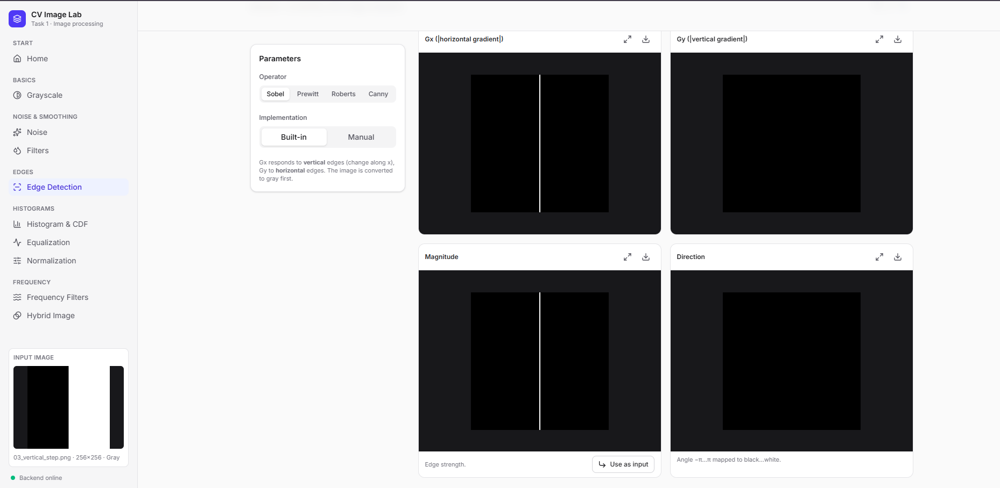 

Sobel — horizontal step; Gy detects the boundary
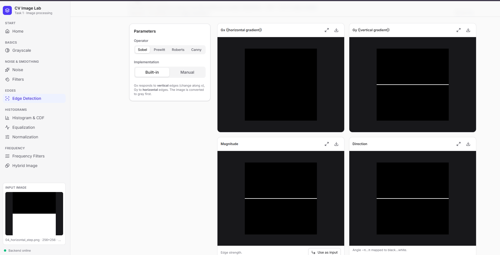 

Prewitt — original vertical step
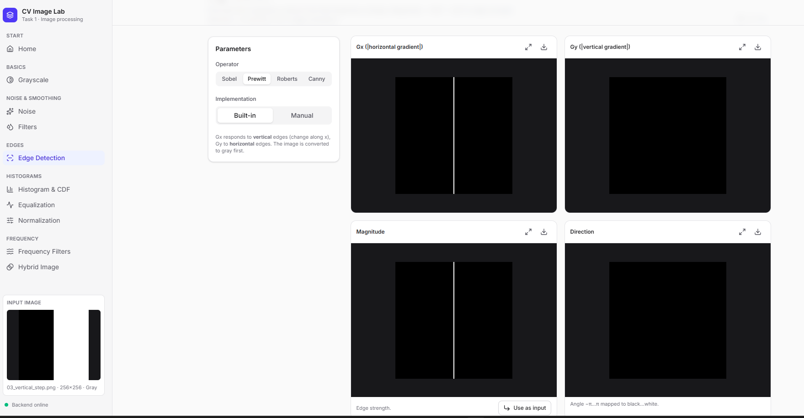 

Roberts — original vertical step, diagonal responses
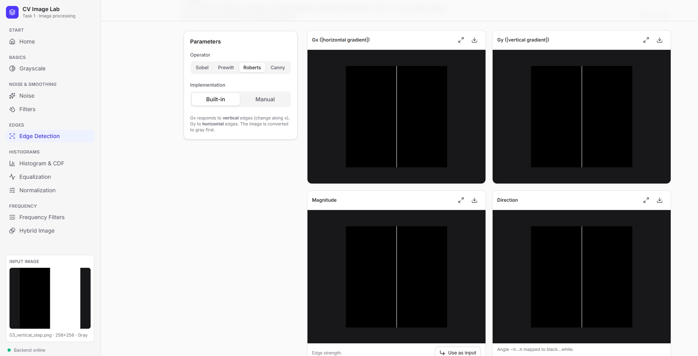 

Canny — clean RGB patches, thresholds 20/60, Gaussian pre-blur sigma 1
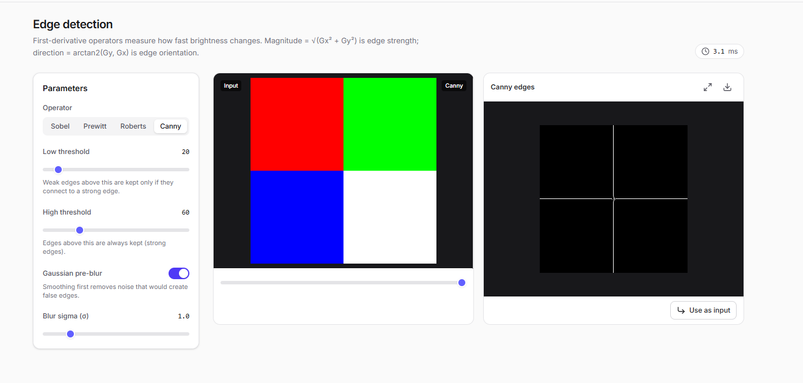 

4 and 8. Histograms, PDF and CDF
For each grayscale or RGB channel:
\(h(k)=\#\{\text{pixels with value }k\},\qquad p(k)=\frac{h(k)}{N},\qquad C(k)=\sum_{i=0}^{k}p(i).\)
Histogram bars show counts. The CDF shows the fraction of pixels with channel value less than or equal to a level. A steep CDF rise indicates many pixels in that range; a flat part indicates few or none. The CDF is nondecreasing and ends near one for a nonempty image.
The API includes histogram, PDF, CDF, minimum, maximum, mean and population standard deviation. The UI plots histogram/CDF and shows channel statistics. RGB channel values describe channel intensity rather than overall grayscale brightness.
The ramp fixture has exactly 256 pixels at every gray level, mean 127.5 and a steadily rising CDF. RGB patches expose channel order and concentrated histogram peaks.
Histogram and CDF examples
Grayscale ramp — histogram and cumulative probability
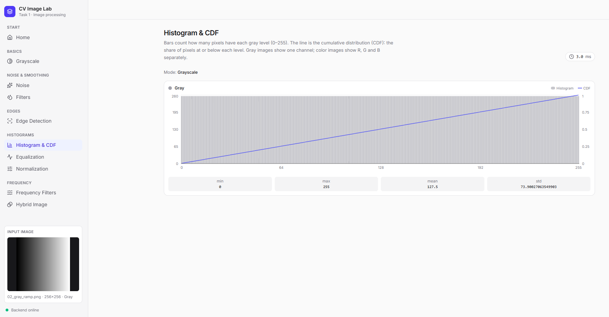

RGB patches — separate red, green and blue distributions
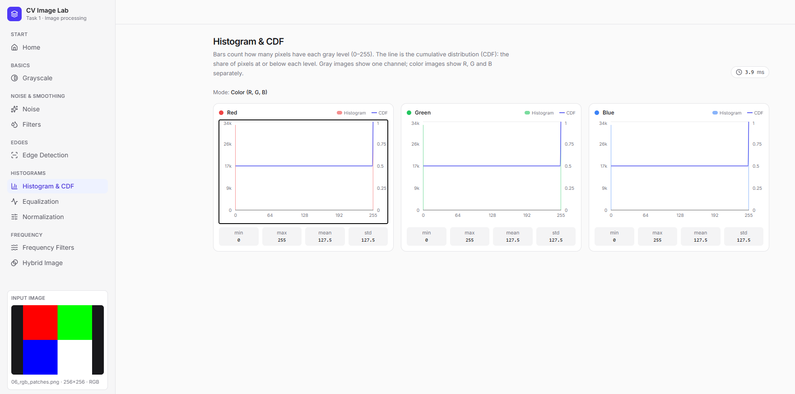 

5. Histogram equalization
The implementation builds a per-channel lookup table:
\(T(k)=\operatorname{round}(255\,C(k)),\qquad I_{out}(x,y)=T(I_{in}(x,y)).\)
Pixels with the same original value receive the same new value. The mapping uses the full intensity distribution, so it is generally nonlinear. The project does not subtract the first nonzero CDF; therefore exact output can differ from other equalization implementations.
For [0, 0, 1, 2], the result is [128, 128, 191, 255]. A constant grayscale image maps to 255 under this formula. Discrete input peaks remain peaks, so equalization does not guarantee a flat histogram or improved contrast for every image. It can amplify visible noise. RGB channels are equalized independently, which can change colours.
Equalization example
Input: 07_low_contrast.png. Include the original, equalized output and before/after distributions.
Direct-CDF equalization of the low-contrast input
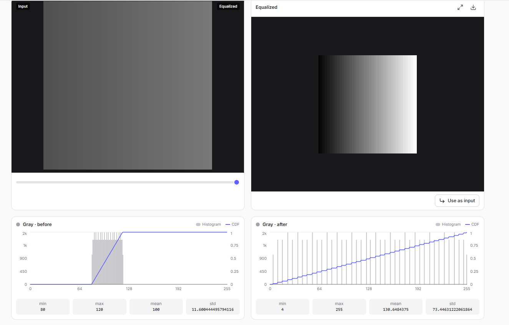 

6. Min-max normalization
\(I_{out}=\operatorname{round}\left(\frac{I-I_{min}}{I_{max}-I_{min}}\times255\right).\)
Normalization stretches the observed range linearly. It uses one global minimum and maximum over the RGB array, applying the same mapping to all channels. A constant image returns zeros with the default output range to avoid division by zero.
For [100, 105, 110], the output is [0, 128, 255]. A full-range 0–255 image remains unchanged. The low-contrast fixture spans 80–120 and should stretch to 0–255. Normalization does not remove noise or use the CDF.
Normalization example
Reupload the same original 07_low_contrast.png used above. Its 80–120 range is stretched to 0–255.
Min-max normalization — original and normalized distributions
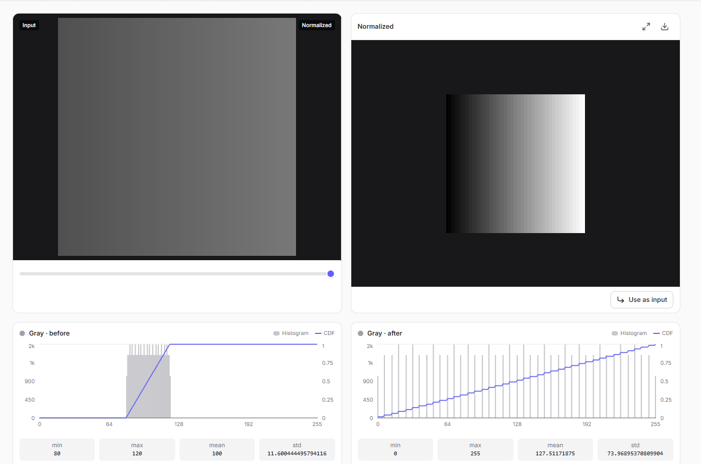 

7. Grayscale conversion
\(Y=0.299R+0.587G+0.114B.\)
The weighted sum gives one brightness-related channel. The implementation clips and casts to uint8, truncating fractions: pure red, green and blue become 76, 149 and 29 respectively. Already-grayscale input is returned unchanged.
This simplifies brightness-edge processing, with the tradeoff that boundaries between colours with similar grayscale values can become weak or disappear.
Grayscale example
Input: 06_rgb_patches.png. The clean colour patches become brightness levels 76, 149, 29 and 255.
Weighted RGB-to-grayscale conversion
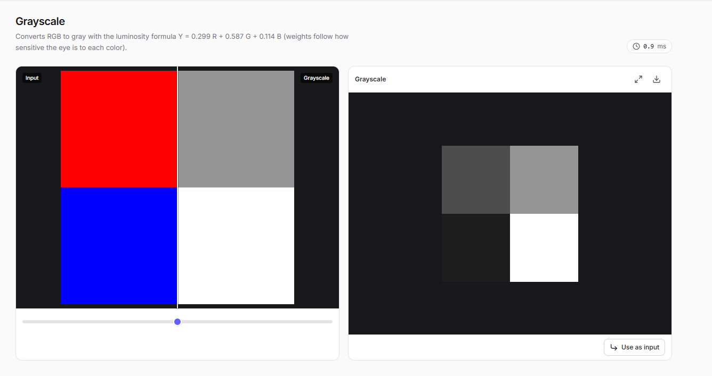 

9. Frequency-domain filtering
For each channel, the implementation computes:
\(F=\operatorname{fftshift}(\operatorname{fft2}(I)),\qquad G=FH,\)
\(g=\Re\left\{\operatorname{ifft2}(\operatorname{ifftshift}(G))\right\}.\)
Let D be distance from the shifted spectrum centre, D₀ the cutoff, and n the Butterworth order:
Mask	Low-pass formula	Interpretation
Ideal	1 if D ≤ D₀, otherwise 0	Abrupt circular cutoff; can cause ringing
Gaussian	exp(−D² / (2D₀²))	Smooth transition; weight at D₀ is about 0.607
Butterworth	1 / (1 + (D/D₀)^(2n))	Adjustable sharpness; weight at D₀ is 0.5

High-pass is the complement: H_HP = 1 − H_LP. Smaller low-pass cutoff generally gives stronger blur. Larger high-pass cutoff suppresses more broad structure, retaining progressively finer content. Higher Butterworth order sharpens the transition.
The UI cutoff unit refers to frequency-grid distance, not a spatial kernel size. Spectra use log(1 + |F|) for visibility and are independently normalized. The filtering calculation retains the original complex coefficients and their phase information.
High-pass raw output is signed. The Frequency page displays clip(raw + 128, 0, 255), so mid-gray represents zero. A constant image therefore has a roughly mid-gray high-pass preview, not a black one.
Frequency-filter examples
Use 15_hybrid_A_disk.png for the Gaussian low/high-pass examples. Capture the spectrum, mask, filtered spectrum and result.
Gaussian low-pass — disk input, cutoff 10
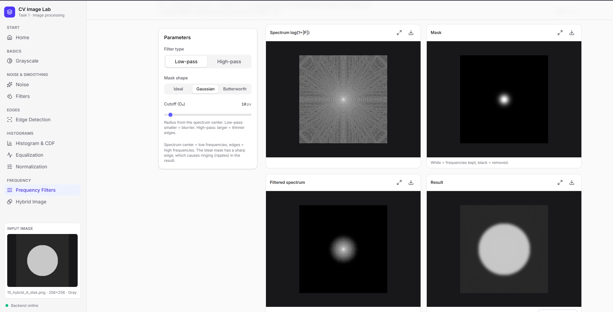

Gaussian high-pass — same disk input, cutoff 10
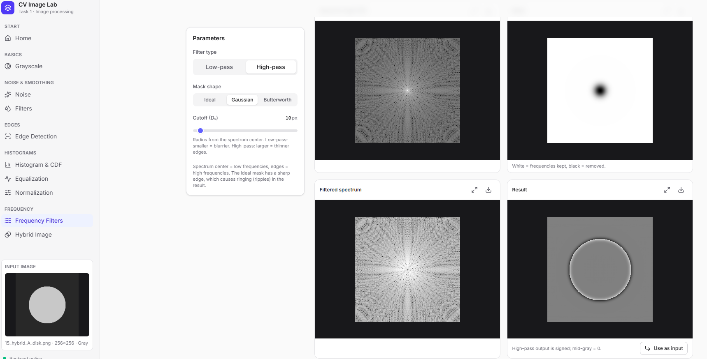

For the shape comparison below, reupload 03_vertical_step.png and keep cutoff 10. Compare the edge transition and any visible ripples.
Ideal low-pass — vertical step, cutoff 10
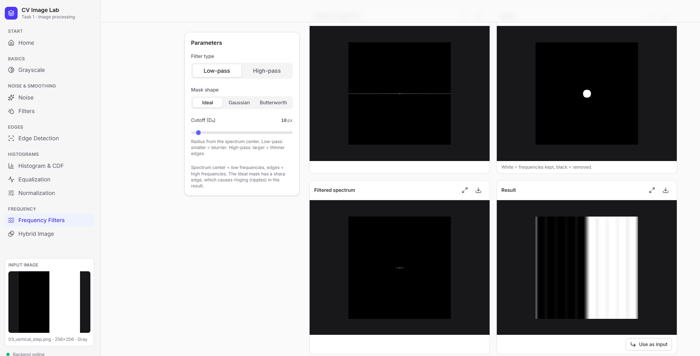 

Butterworth low-pass — same vertical step, cutoff 10, order 2
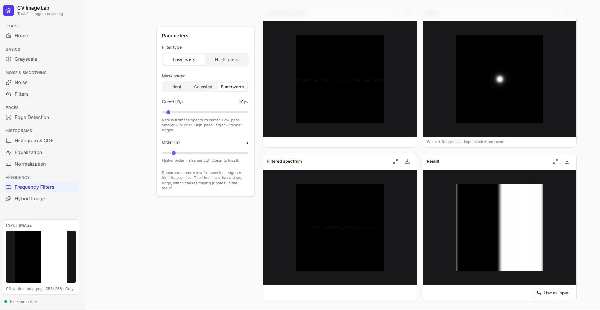 

10. Hybrid images
\(I_{hybrid}=\operatorname{clip}\left(LP(A)+HP(B),\ 0,\ 255\right).\)
B is resized to A's dimensions. If either decoded input is grayscale, both are converted to grayscale; otherwise RGB processing is retained. Each component is filtered per channel.
The signed high-pass output is added before clipping. For example, low-pass value 150 plus high-pass detail −30 gives 120; clipping the detail first would incorrectly give 150. Display-normalized high-pass previews are not used in the calculation.
The Hybrid page displays low-pass A, a min-max-stretched high-pass B preview, and the combined image. Smaller-view panels reuse the same image at reduced display sizes. They help demonstrate how high-frequency details become less visible at smaller viewing sizes; the perceptual effect depends on suitable inputs, alignment, contrast and settings.
The Hybrid API uses default Butterworth order 2 because it does not expose a separate order parameter.
Hybrid example
A: 15_hybrid_A_disk.png. B: 16_hybrid_B_stripes.png. Use Gaussian filters with low cutoff 15 and high cutoff 25.
Hybrid composition — inputs, low-pass A, high-pass B and combined output
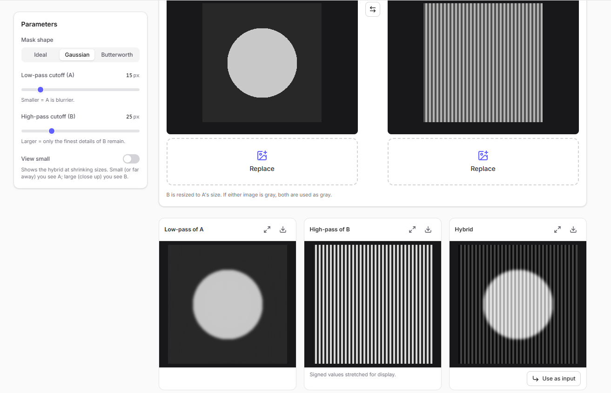

The broad disk and stripe details illustrate composition. The high-pass component shown here is normalized only for viewing.
The same hybrid at decreasing viewing sizes
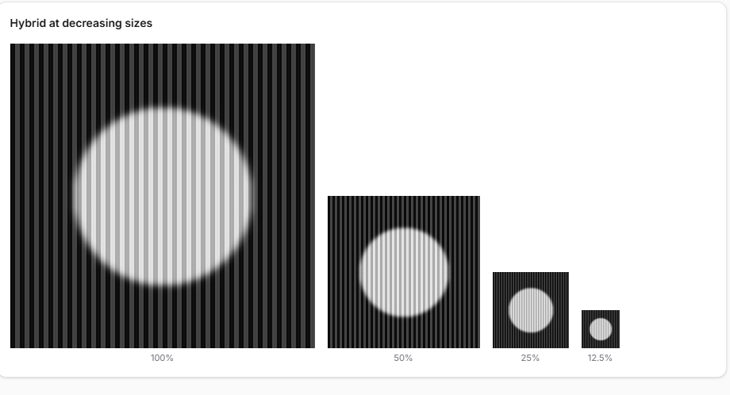

A second optional pair of aligned portraits can demonstrate the perceptual effect. Record permitted image sources and the actual settings used.
API reference
All processing endpoints use POST JSON. Image fields contain encoded image strings/data URLs, not filesystem paths. GET /api/health returns {"status":"ok"}.
Endpoint	Main request fields	Main response content
GET /api/health	None	Backend status
POST /api/grayscale	image	Converted image
POST /api/noise	image, type, seed and type-specific parameters	Noisy result
POST /api/filter	image, method, kernel_size, implementation, Gaussian sigma	Result or manual/built-in/difference panels and comparison data
POST /api/edges	image, method, implementation; Canny low, high, blur_sigma	Gradient panels or Canny result
POST /api/histogram	image	Channel distributions and statistics
POST /api/equalize	image	Equalized result and before/after data
POST /api/normalize	image	Normalized result and before/after data
POST /api/frequency	image, kind, shape, cutoff, order	Result, mask and spectrum previews
POST /api/hybrid	image_a, image_b, low_cutoff, high_cutoff, shape	Hybrid and component previews

See http://localhost:8000/docs for the exact live schema and required fields. Processing responses group images under images, optional numerical data under data, and elapsed processing time under meta.time_ms. Exact timed regions vary by route; these times do not represent complete browser round-trip latency.
Tested invalid parameters and empty image data receive readable HTTP 400 responses. Missing/incompatible schema fields can produce HTTP 422. These are separate from unexpected HTTP 500 server errors.
Testing and evidence
Run the backend suite
From the repository root, after backend dependencies are installed:
cd backend
.\.venv\Scripts\Activate.ps1
python -m pip install pytest httpx
python -m pytest -q tests ..\CV_Test_Kit\qa_tests --tb=short
The test-only tools are installed into the virtual environment. The command requires CV_Test_Kit beside backend and frontend.
Recorded results
Scope	Recorded result	Evidence status
Repository and extended backend tests	230 passed	Recorded on the maintainer's Windows checkout; retain a terminal screenshot/log
Manual browser workflows	Separate checklist	Record outcomes in CV_Test_Kit/manual_results.csv
Frontend production build	Run npm run build	No build result asserted here

The one warning in the reported run concerned TestClient/HTTPX deprecation and did not fail the tests. Dependency changes can alter warnings or results. The count is a recorded result, not a permanent guaranteed count.

Capture fresh automated evidence
From backend/:
python -m pytest -q tests ..\CV_Test_Kit\qa_tests --tb=short 2>&1 | Tee-Object -FilePath ..\CV_Test_Kit\windows_test_run.txt
Record the tested revision from the project root:
git rev-parse HEAD
Also record whether the working tree had uncommitted changes. Run tests on the committed revision again if a commit-specific verification claim is needed.
Coverage and scope
The extended kit covers known numerical outputs/properties, grayscale and RGB processing, normal API workflows, invalid parameters, empty/corrupt inputs, extreme dimensions, manual/built-in agreement, FFT reconstruction and signed hybrid addition. The manual plan covers uploads, sliders, charts, navigation, chaining, downloads and recovery.
An in-process API suite does not verify rendering, live CORS behaviour, network performance or all possible images. A screenshot illustrates one observed run; it does not replace a numerical test.
Limitations and interpretation
- Edge detection uses grayscale brightness, which can suppress colour-only boundaries. Roberts components are diagonal, and the direction preview is not a fixed calibrated angle legend.
- Equalization can amplify noise, alter RGB colours and leave histogram peaks. It does not guarantee a flat histogram or perceptual improvement.
- Global normalization can be influenced by extreme values; it does not necessarily change full-range inputs.
- FFT filtering assumes periodic boundaries; this implementation does not pad the image before transforming, so wraparound/border artefacts can occur.
- Circular masks use raw frequency-bin distances; rectangular dimensions require care when interpreting physical spatial frequencies.
- Display conversion can clip, shift or normalize raw results. Downloading/reusing a preview uses those display pixels, not the original signed intermediate array.
- Hybrid resizing matches dimensions but does not align objects or preserve B's aspect ratio when the ratios differ. Good perceptual hybrids need suitable source images.
- Large manual median neighbourhoods can increase memory use. Timing ratios from one run are not general benchmarks.
- Browser state is in memory. Parameter changes can trigger processing again after promoting a result to the working input.
- The test suite provides evidence for its cases, not exhaustive correctness or production deployment/security readiness.
Team contributions
Role	Contributor	Responsibility
Lead	Yomna Sabry	Interface, shared utilities, grayscale conversion and integration
Member B	Add confirmed contributor name	Noise, spatial filters and correlation engine
Member C	Hana Gamal	Edge detection, frequency filters and hybrid images
Member D	Add confirmed contributor name	Histograms, PDF/CDF, equalization and normalization

The table reflects project ownership headers and the known Member C role. Confirm final names and any shared contributions with the team before submission.
References
Project-specific behaviour is documented from the source files linked in the repository structure. External references explain the underlying operations:
1. NumPy array indexing
2. NumPy padding modes
3. SciPy multidimensional correlation and border modes
4. SciPy median filtering
5. OpenCV Sobel derivatives
6. OpenCV Canny tutorial
7. OpenCV histogram equalization background — implementation variants can differ from this project's direct-CDF formula.
8. NumPy cumulative sum
9. NumPy FFT conventions
10. FastAPI error handling
11. FastAPI testing
12. pytest usage
13. Original hybrid-image research — Oliva, Torralba and Schyns